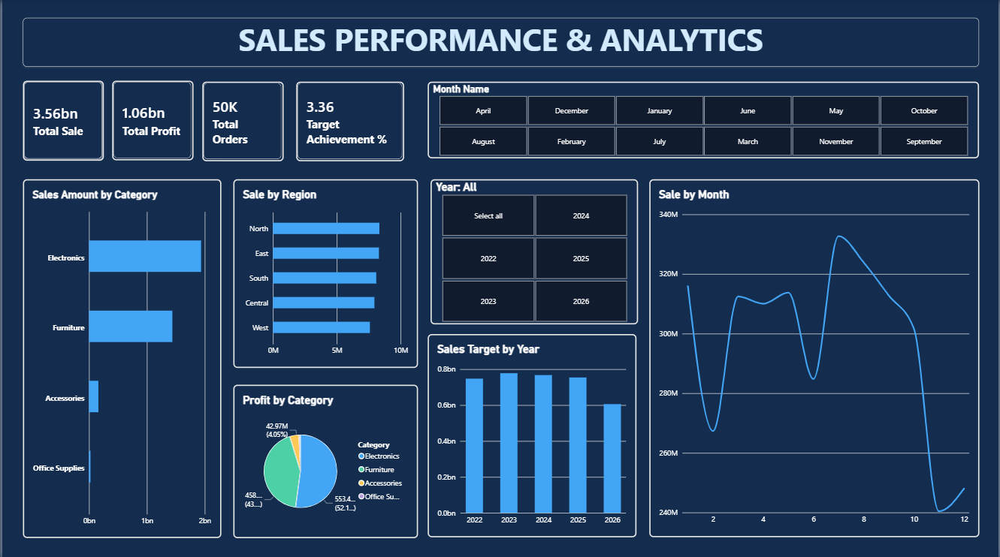
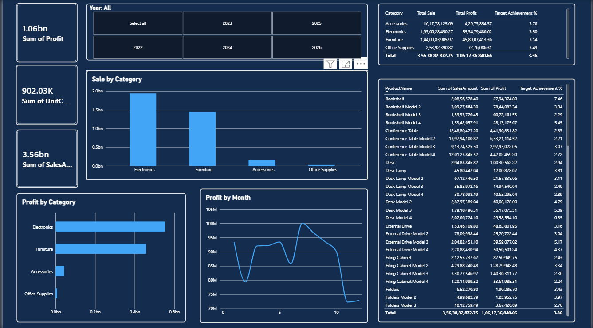
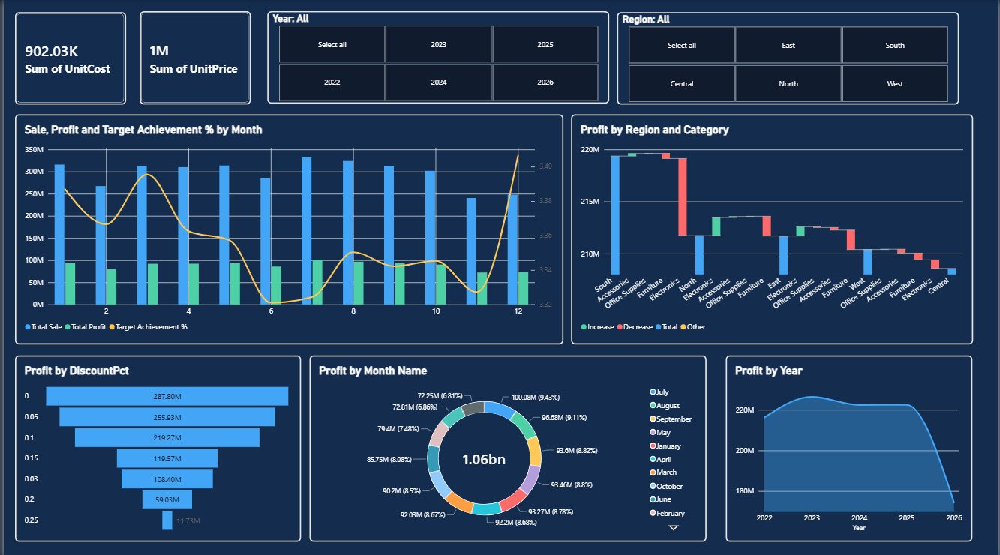

# SALES PERFORMANCE & TARGET ACHIEVEMENT DASHBOARD
## Power BI Project Report

### 1. Introduction

The Sales Performance & Target Achievement Dashboard is a data analytics and visualization project developed using Microsoft Power BI. The main purpose of this project is to analyze business sales data, evaluate profitability, and compare actual sales performance with assigned sales targets.

The dashboard combines sales information with customer details, product information, and sales target data to provide a comprehensive view of business performance. It presents important metrics such as total sales, total profit, total orders, total quantity, sales targets, target achievement percentage, and sales variance.

Interactive charts, KPI cards, tables, and slicers are used to analyze performance across different regions, product categories, and time periods. The dashboard helps identify high-performing areas, understand gaps in target achievement, and support data-driven business decisions.

### 2. Objectives

- To analyze overall sales performance and business profitability.
- To calculate total sales, total profit, total quantity, and total orders.
- To compare actual sales with assigned sales targets.
- To calculate target achievement percentage and sales variance.
- To analyze monthly and yearly sales performance.
- To compare sales and profit across different regions.
- To identify high-performing and low-performing product categories.
- To analyze customer segments and product contributions.
- To create interactive visualizations using KPI cards, charts, and slicers.
- To identify performance gaps and potential opportunities for business improvement.

### 3. Tools and Technologies Used

- **Microsoft Power BI Desktop:** Used to develop the interactive dashboard and visualize business performance.
- **CSV Datasets:** Used to store sales transactions, customer details, product information, and sales targets.
- **Power Query Editor:** Used for data cleaning, transformation, and preparation.
- **DAX (Data Analysis Expressions):** Used to calculate KPIs, target achievement, sales variance, and profitability measures.
- **Power BI Model View:** Used to create and manage relationships between the datasets.
- **Power BI Visualizations:** Used to represent sales trends, profit comparisons, regional performance, and target achievement.
- **GitHub:** Used to store and share project datasets, dashboard files, and documentation.

### 4. Dataset Description

The project uses four CSV datasets containing sales transactions, customer information, product details, and sales targets.

**4.1 Sales Dataset (`sales.csv`)**

This dataset contains transaction-level information used to analyze actual sales performance.

Important fields may include:
- Order ID
- Order Date
- Customer ID
- Product ID
- Sales
- Profit
- Quantity
- Discount
- Region
- Category
- Target Key

**4.2 Customers Dataset (`customers.csv`)**

This dataset contains customer-related information used to analyze customer segments and regional performance.

Important fields may include:
- Customer ID
- Customer Name
- Customer Segment
- Region

**4.3 Products Dataset (`products.csv`)**

This dataset contains product details used to compare sales and profitability across different product categories.

Important fields may include:
- Product ID
- Product Name
- Category
- Subcategory

**4.4 Targets Dataset (`targets.csv`)**

This dataset contains assigned sales targets used to evaluate actual performance against business goals.

Important fields may include:
- Target Key
- Year
- Month
- Region
- Category
- Sales Target

The four datasets work together to provide a broader understanding of sales performance, customer behavior, product contribution, and target achievement. The exact column names depend on the final CSV files used in the project.

### 5. Methodology

The project follows a systematic data analytics process.

**Step 1: Data Import**

The four CSV datasets were imported into Microsoft Power BI Desktop for analysis.

**Step 2: Data Cleaning and Transformation**

The datasets were examined using Power Query Editor. Column names, data types, missing values, duplicate records, and inconsistent values were checked. Date and numerical columns were prepared for analysis wherever necessary.

**Step 3: Data Modeling**

Relationships were established between the sales, customers, products, and targets datasets using appropriate key columns. The relationships allow related information to be used for analysis and filtering.

**Step 4: DAX Measure Creation**

DAX measures were developed to calculate total sales, total profit, total orders, total quantity, sales targets, target achievement percentage, and sales variance.

**Step 5: Sales Performance Analysis**

Sales performance was analyzed across different time periods, product categories, customer segments, and geographical regions.

**Step 6: Target Achievement Analysis**

Actual sales were compared with assigned sales targets to identify the difference between business performance and expected goals.

**Step 7: Dashboard Development**

KPI cards, bar charts, column charts, line charts, tables, and slicers were added to present the results in an interactive format.

**Step 8: Dashboard Formatting and Validation**

A consistent visual theme was applied. Calculations, relationships, filter interactions, and target comparisons were checked to improve the accuracy and readability of the dashboard.

### 6. DAX Measures and Calculations

DAX measures are used to calculate the main performance indicators required for sales and target analysis.

**6.1 Total Sales**

Calculates the total revenue generated from sales transactions.

```dax
Total Sales =
SUM('sales'[Sales])
```

**6.2 Total Profit**

Calculates the total profit generated from sales.

```dax
Total Profit =
SUM('sales'[Profit])
```

**6.3 Total Quantity**

Calculates the total quantity of products sold.

```dax
Total Quantity =
SUM('sales'[Quantity])
```

**6.4 Total Orders**

Calculates the number of unique orders.

```dax
Total Orders =
DISTINCTCOUNT('sales'[Order ID])
```

**6.5 Total Sales Target**

Calculates the assigned sales target for the selected reporting context.

```dax
Total Sales Target =
SUM('targets'[Sales Target])
```

**6.6 Target Achievement Percentage**

Calculates the percentage of the sales target achieved.

```dax
Target Achievement % =
DIVIDE(
    [Total Sales],
    [Total Sales Target],
    0
)
```

Format this measure as a percentage.

**6.7 Sales Variance**

Calculates the difference between actual sales and the assigned target.

```dax
Sales Variance =
[Total Sales] - [Total Sales Target]
```

A positive value indicates sales above target, while a negative value indicates sales below target.

**6.8 Profit Margin**

Calculates profit as a percentage of sales.

```dax
Profit Margin =
DIVIDE(
    [Total Profit],
    [Total Sales],
    0
)
```

Format this measure as a percentage.

**6.9 Average Sales per Order**

Calculates the average sales value per unique order.

```dax
Average Sales per Order =
DIVIDE(
    [Total Sales],
    [Total Orders],
    0
)
```

These measures provide a foundation for analyzing revenue, profitability, and target achievement. Table and column names must match the actual Power BI model. Target comparisons must also use consistent filters and reporting periods to avoid incorrect totals.

##  Dashboard Screenshot







### 7. Results and Insights

The dashboard provides a consolidated view of sales, profitability, and target achievement.

- **Overall Sales Performance:** Total Sales and Total Orders provide an overview of business activity.
- **Profitability Analysis:** Total Profit and Profit Margin help evaluate the financial contribution of sales.
- **Target Achievement:** The comparison between actual sales and assigned targets indicates the extent to which business goals are being achieved.
- **Sales Variance:** Positive and negative variances help identify performance above or below the assigned target.
- **Regional Performance:** Region-wise comparisons highlight differences in sales and target achievement across geographical areas.
- **Category Performance:** Category-wise analysis identifies differences in sales contribution and profitability.
- **Time-Based Analysis:** Monthly and yearly trends help reveal changes in sales performance over time.
- **Customer and Product Contribution:** Customer segment and product comparisons help identify important contributors to revenue.

The actual highest-performing region, most profitable category, target achievement percentage, and other numerical findings should be added after examining the completed dashboard. These findings depend on the values in the datasets and the final Power BI calculations.

### 8. Conclusion

The Sales Performance & Target Achievement Dashboard demonstrates how Microsoft Power BI can be used to analyze business data and monitor performance against assigned goals.

By integrating sales transactions, customer details, product information, and target data, the dashboard provides a structured view of sales, profitability, and target achievement. DAX measures are used to calculate important KPIs, while interactive visualizations help compare actual sales with targets across regions, categories, and reporting periods.

The dashboard supports the identification of performance gaps, profitable product categories, regional differences, and sales trends. It provides a practical foundation for business performance monitoring and data-driven decision-making.

This project also develops practical skills in data cleaning, data modeling, DAX calculations, data visualization, and interactive dashboard development using Microsoft Power BI.

### 9. Project Files

The project repository may contain the following files:

- **Sales Dataset (`sales.csv`):** Contains sales transaction records.
- **Customers Dataset (`customers.csv`):** Contains customer-related information.
- **Products Dataset (`products.csv`):** Contains product and category details.
- **Targets Dataset (`targets.csv`):** Contains assigned sales targets.
- **Power BI Dashboard (`.pbix`):** Contains the data model, DAX measures, and interactive visualizations.
- **Dashboard Screenshots (`.png`):** Display the completed dashboard pages.
- **Project Report (`.pdf`):** Documents the project objectives, methodology, calculations, and results.
- **README.md:** Provides the project overview, dataset descriptions, tools, and instructions.

### 10. References

1. Microsoft Power BI: https://powerbi.microsoft.com/
2. Microsoft Power Query Documentation: https://learn.microsoft.com/power-query/
3. Microsoft DAX Documentation: https://learn.microsoft.com/dax/
4. GitHub: https://github.com/

